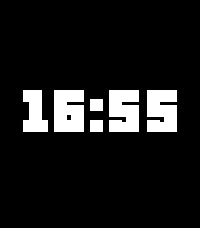
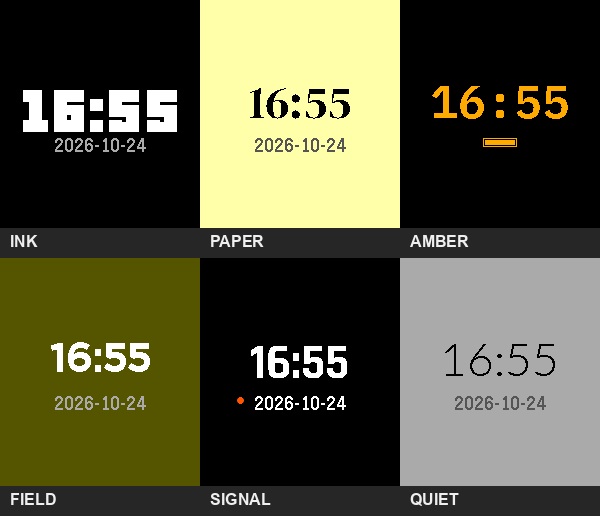

# Level Time

A Pebble Time 2 watchface concept: the watch rolls with your wrist while the digital time counter-rotates so its digits stay level. The time remains flat, legible 2D text on the watch screen. The watchface does not draw a floating card or project a hologram.

The native Emery watchface is implemented in `watchface/`. It uses the accelerometer to counter-rotate the clock inside the display. The selected style and date format are saved on the watch.

## Six settings styles

The **Style** selector in the Pebble phone settings page includes all six accepted looks. Ink is the default.

| Style | Display | Time | Supporting detail |
| --- | --- | --- | --- |
| [Ink](design/renders/ink.png) | Black | White block LECO | Small gray date |
| [Paper](design/renders/paper.png) | Warm ivory | Charcoal DM Serif Display | Small dark date |
| [Amber](design/renders/amber.png) | Black | Amber IBM Plex Mono | Small battery indicator |
| [Field](design/renders/field.png) | Dark olive | Off-white bold Bitham | Small pale date |
| [Signal](design/renders/signal.png) | Black | White condensed Rajdhani | Orange accent dot and date |
| [Quiet](design/renders/quiet.png) | Light gray | Charcoal light Lato | Small gray date |

The reference renders show each style at three watch angles. Their colors and layouts are design targets; the native version now uses distinct typography for every style. The renders are not emulator captures or proof of final Pebble pixels.

## Native previews



The [six native screenshots](media/native/) are captured from the Emery emulator. The [animated store banner](media/store/emery_banner.gif) places those native display frames in an illustrated rotating case. It is promotional artwork, not a photo of a physical watch.



[Level Time is published in the Pebble watchface store](https://apps.repebble.com/450af5416e634355b0e326f9). Version 0.1.1 is listed for Pebble Time 2. The gallery starts with the native tilt GIF, then a [six-style GIF](media/store/emery_01_six_styles.gif), followed by Paper, Amber, and Quiet stills. The developer dashboard accepted the banner but stored it as a static PNG.

## Build

```bash
cd watchface
npm ci
pebble build
```

The PBW is `watchface/build/watchface.pbw`. It targets Pebble Time 2 (`emery`) only. Run the host motion check with `cc -DLEVEL_HOST -I watchface/src/c tests/host/test_level_math.c watchface/src/c/level_math.c -lm -o .tmp/test_level_math && .tmp/test_level_math` from the repository root.

The current published build is preserved at [release/Level-Time-0.1.1.pbw](release/Level-Time-0.1.1.pbw). The previous 0.1.0 binary remains in `release/` for history.

Physical watch readability, motion feel, and battery impact remain unmeasured.

See [the design brief](docs/DESIGN.md) for the motion rule, settings contract, and implementation limits. See [task.md](task.md) for the current milestone.
